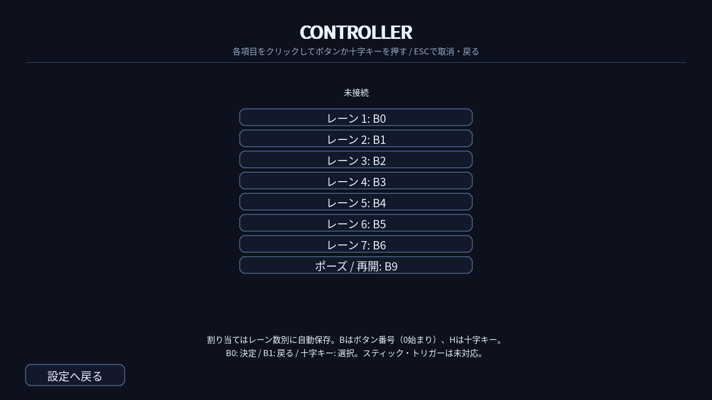

# コントローラー対応

設定画面右下の「コントローラー設定」で、各レーンと「ポーズ / 再開」をクリックし、割り当てたいボタンまたは十字キーを押します。ESCで入力待ちをキャンセルできます。割り当ては3・5・7レーン別に自動保存されます。キーボード設定はそのまま使えます。

- Windows / Pygameがジョイスティックとして認識する機器を使用します。起動後の接続にも対応します。
- 初期値はレーン順にB0〜B6（レーン数分）、ポーズはB9です。Bは0始まりの機器側ボタン番号です。Xbox / PlayStationの表記との対応は機種・ドライバーにより異なるため、使用前に割り当ててください。
- H0L/R/U/Dは十字キーの左・右・上・下です。十字キーは反対方向の同時押しができません。同時押し譜面には独立したボタンへの割り当てをおすすめします。
- メニューではB0がEnter、B1がESC、十字キーが矢印キー相当です。ファイル選択や細かな設定・ボタン割り当てにはマウス／キーボードを使います。
- アナログスティックと、アナログ軸として報告されるトリガーは未対応です。ボタンとして報告されるトリガーは割り当てできます。振動はありません。
- 複数のコントローラーは同じ割り当てで操作します。キーボードと併用しても、いずれかで押しているレーンのHOLDは継続します。
- 切断・フォーカス喪失時はプレイを停止します。接続を確認してから再開してください。再開時に押しっぱなしのボタンで新しいTAPを判定しません。離してから押し直してください。

## 実機確認

自動テストは入力イベントの模擬であり、USB/Bluetooth機器での確認は別途必要です。

1. 接続名が表示されること、各レーンとポーズの割り当て・再起動後の保存を確認。
2. 同時押し、連打、HOLD開始・終端、キーボードとの併用を確認。
3. ポーズ中にボタンを離す／押し続ける、再開後に押し直す操作を確認。
4. プレイ中に切断して停止し、再接続後に再開できることを確認。
5. USBとBluetoothで遅延が異なる場合は、既存のタイミング調整を使用。

ソースへの追加です。配布用EXE/ZIPへの反映には再ビルドが必要です。

## 画面例

7レーンの割り当て画面（コントローラー未接続時）。

