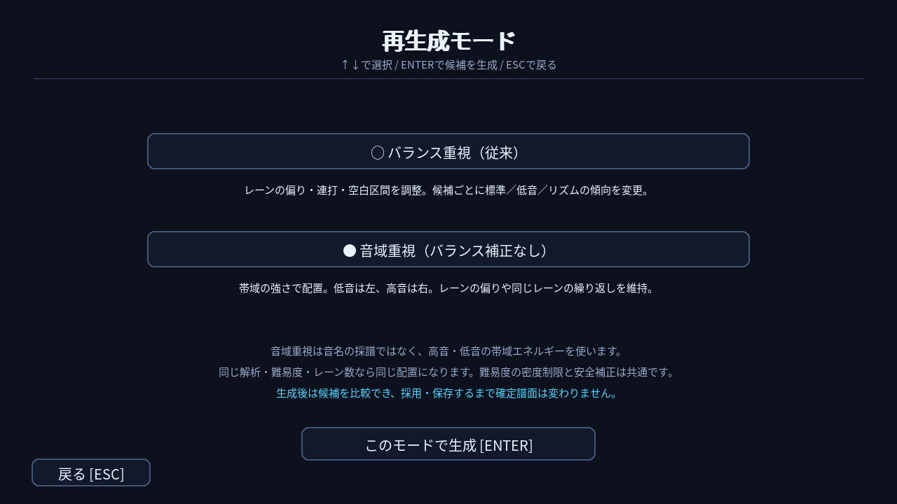
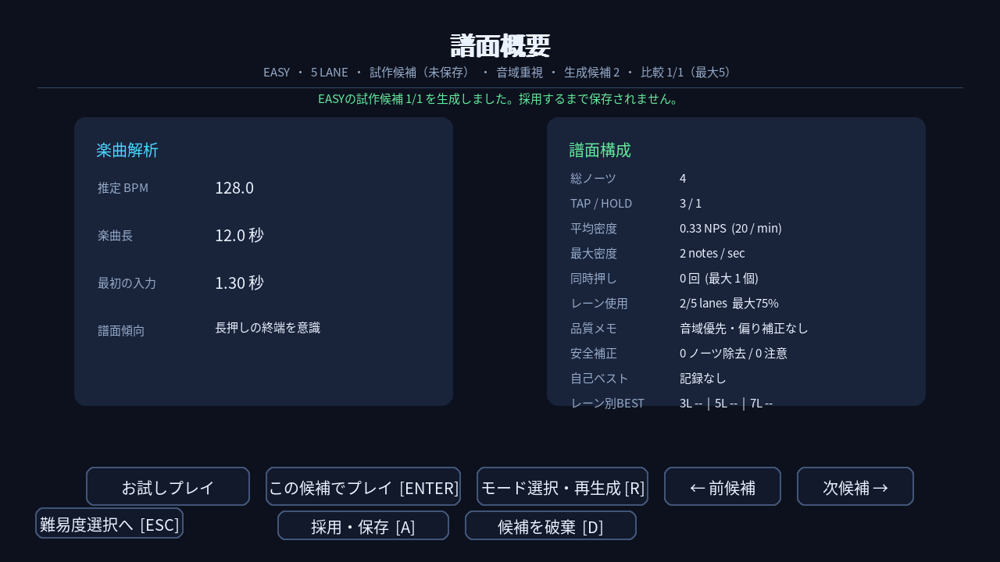

# 譜面の再生成モード

譜面概要の「モード選択・再生成 [R]」から選択します。上下キーまたはクリックで選び、Enterまたは生成ボタンで試作します。ESCで戻った場合、譜面は変わりません。コントローラーの十字キーと決定ボタンでも操作できます。

## バランス重視（従来）

従来どおり、レーン負荷の分散、連打の交互配置、空白区間への再配置を行います。曲の特徴に応じて、候補ごとに標準・低音重視・リズム重視の傾向を切り替えます。

## 音域重視（バランス補正なし）

解析済みの5帯域の強さから、低音を左、高音を右へ直接対応させます。最も強い帯域を優先し、同時押しが許される難易度では他の強い帯域も候補にします。無音・帯域データがない位置にはTAPを作りません。音名やメロディーを推定するモードではありません。

打楽器・小節頭による中央寄せ、同一レーンの連打回避、候補番号による左右反転、交互ロールへの変更、レーン分散、空白区間の補正を行いません。入力位置の選抜にも打楽器の強さを加重せず、onsetの強さを使います。

難易度別の入力間隔・密度・同時押し数・HOLD比率の制限、拍への微調整、開始前の助走、押せないHOLD衝突などの安全チェックは維持します。ノーツを別レーンや空白区間に移動して均すことはありません。低音が強い曲では左に集中します。5帯域を対応付けるため、7レーンでは全レーンを使うとは限りません。

同じ解析・難易度・レーン数なら、何度生成しても同じ配置になります。生成候補番号は比較履歴として増えます。

どちらのモードも未保存候補として最大5件まで比較できます。「採用・保存」を行った時だけ、その曲・難易度・レーン数の確定譜面を置き換えます。モード別の独立したランキングや保存枠は追加していません。既存の確定譜面を自動で再生成する変更もありません。

## 画面例

音域重視で生成した未保存候補の概要。テスト用楽曲データによる表示例です。

